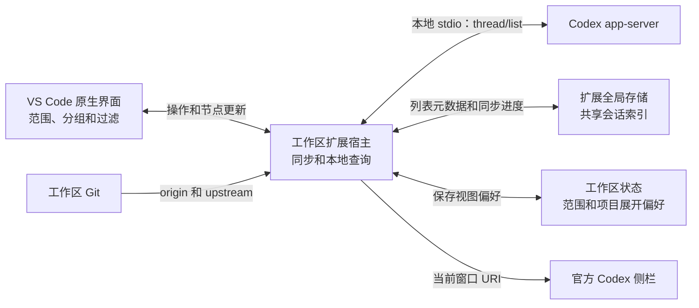

# Codex Chats List 架构

宿主从本地 app-server 首次逐页同步，再从共享索引按范围、目录或仓库加载树节点。同一存储范围下只有持有租约的窗口回源同步。点开会话时，宿主按 ID 校验该条元数据后跳转到官方侧栏。

查询与视图行为见 [DESIGN.md](DESIGN.md)，存储结构见 [history-schema.md](docs/history-schema.md)。
