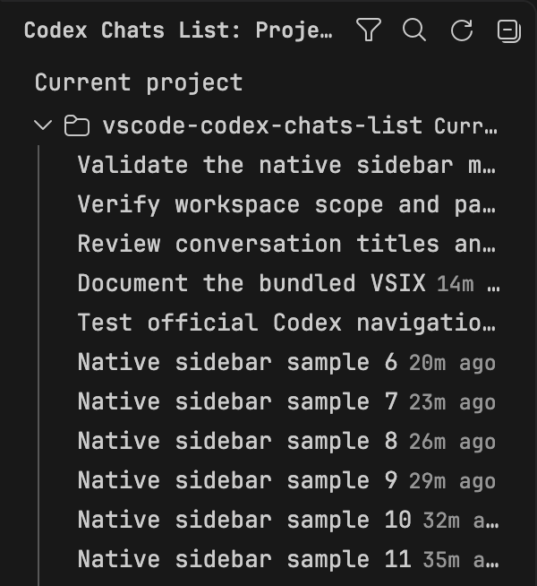
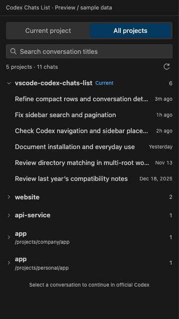
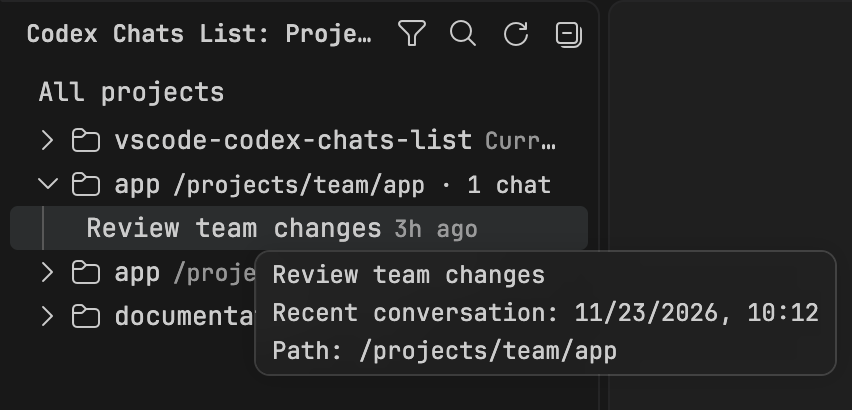

# Codex Chats List

English · [简体中文](README.zh-CN.md)

Browse Codex conversations by project, then continue in the official Codex sidebar. The native VS Code tree supports project groups and title search.

## Install and browse

1. Install and sign in to the [official Codex extension](https://marketplace.visualstudio.com/items?itemName=openai.chatgpt).
2. Search `@id:pujie.codex-chats-list` in VS Code to install **Codex Chats List**, or choose **Extensions → … → Install from VSIX** for a local package.
3. Open a project folder and select **Codex Chats List** in the Activity Bar. You can also run **Codex Chats List: Open Project Chats** from the Command Palette.
4. Expand a project and select a conversation. It opens in the existing official Codex sidebar, wherever you placed it.

[Marketplace listing](https://marketplace.visualstudio.com/items?itemName=pujie.codex-chats-list) · [Report a problem](https://github.com/jaypume/vscode-codex-chats-list/issues)

| Action | How it works |
| --- | --- |
| Switch the scope | Click the filter button in the view toolbar to switch between **Current project** and **All projects**. |
| Group and filter | Use **Group Conversations** to select **By Repository** or **By Folder**. The view menu has **Toggle Non-Git Folders**. |
| Search titles | Select the magnifier and type a title keyword. The tree updates within the selected scope, **Current project** or **All projects**. Enter keeps the filter and Escape restores the previous results. Use **Clear Conversation Search** to reset it. |
| See details | A project's right-hand badge shows its conversation count, capped at `99`, followed by the age of its latest conversation. Activity ages use days, weeks, months, or years. Ages longer than two characters appear after the title. Hover for the exact count, timestamp, or path. |
| Sort all projects | In **All projects**, open the view's **…** menu and choose **Sort Projects**. Sort by name or by the most recent conversation. |
| Pin a project or conversation | Right-click a project group or conversation and choose **Pin** or **Unpin**. Pinned groups come first. Pinned conversations come first within their group. |
| Hide or restore items | Right-click a project group or conversation and choose **Hide**. Use **… → Toggle Hidden Items View** to find hidden items and right-click **Unhide** to restore them. |
| Assign a conversation | Right-click a conversation and choose **Move to Repository…**. Pick a known repository or choose a Git folder. In **By Repository**, Current and All follow the assignment. Use **Restore Automatic Grouping** to clear it. |
| Delete conversations | Right-click a conversation or project group and choose **Delete Conversations…**. Confirm permanent deletion in Codex. Project deletion covers all indexed conversations in the group, including those excluded by the current filters. |
| Load and refresh | **Current project** and **All projects** show all matching indexed conversations. Older conversations appear automatically as the index fills. **Refresh Conversations** checks recent activity. |

With **By Repository**, the current scope matches either the workspace repository’s `origin` or `upstream`. A matching remote also finds conversations from moved checkouts. Local repositories with no remote group under their Git root.

GitHub repository IDs also group conversations across repository renames. Repository details prefer a matching checkout in the current workspace, followed by the most recent verified checkout. Conversation tooltips show the original path. GitHub metadata is cached locally. The extension uses an existing GitHub CLI login for private repositories and can look up public repositories without signing in.

Ordinary folders use their directory names and remain distinct by path. If the folder is missing and Codex saved no Git identity, the group shows **Source unknown**. The folder filter hides only confirmed non-Git folders. **By Folder** keeps separate working-directory groups and matches exact workspace paths for **Current project**.

The first scan builds the index in the background while the view is visible. Results appear as each page arrives. Windows with the same VS Code profile, extension host, and Codex source share the index. After a restart, the view shows cached results and resumes from the saved cursor. Scope, grouping, and title search use the cached results.

The index stores conversation IDs and the metadata needed for the list, such as titles, paths, timestamps, and sanitized repository keys. Codex manages conversation contents. Background updates check recent activity while the view is visible. Selecting a cached conversation checks its metadata with Codex before opening. Older renames or archives may appear stale until that conversation is selected. Hosts without Node SQLite use an in-memory index.

The sort order is saved per workspace. Pins and hidden items are shared by windows on the same VS Code profile and extension host.

Manual assignments apply to the extension's repository view and are shared by windows using the same Codex source. Folder grouping and conversation tooltips retain the original working directory. Opening an assigned conversation resumes the same Codex thread.

## Preview

The native VS Code sidebar below uses synthetic data. [Chinese previews](README.zh-CN.md#界面预览) show the same controls in Simplified Chinese.

| Current project | All projects |
| --- | --- |
|  |  |



## Compatibility and privacy

The manifest requires VS Code 1.100 or newer. The extension follows the VS Code display language, with Simplified Chinese for Chinese locales and English otherwise. Conversation titles and paths retain their original text.

| Situation | Guidance |
| --- | --- |
| Empty current-project tree | Try **By Repository** for conversations from another checkout or worktree. **All projects** shows other indexed directories too. |
| Codex binary unavailable | Enable the official extension or set `codexChatsList.cliPath` to an absolute executable path on the current host. |
| Opening a conversation fails | Open the official Codex sidebar and retry. Include both extension versions when reporting the issue, since the navigation URI comes from the official extension. |
| WSL, SSH, or a container | Install both extensions in the remote workspace. History stays on each host. For Windows with Codex running in WSL, open the project in a WSL window. |

The extension reads conversation IDs, titles, working directories, recent conversation times, and available Git remote metadata from the local bundled `codex app-server`. It uses `thread/list` with `useStateDbOnly`. When a title is missing, the server's first-message preview can supply the label. The official executable manages its internal state and logs. Navigation uses the official extension's existing `/local/<id>` URI handler.

Codex Chats List 1.2.1 can run alongside Codex Project Chats. When `codexChatsList.cliPath` is unset, the fork reads the previous `codexProjectChats.cliPath` value. Set the new key to an empty string to use the official extension's bundled executable. If you assigned a shortcut to the fork's open or refresh command, update it to `codexChatsList.open` or `codexChatsList.refresh`. You can move the new activity bar entry to your preferred position.

## Development and support

Use Node.js 24.18.0 and pnpm 12.15.0 as declared in `.nvmrc` and `packageManager`.

```sh
pnpm install --frozen-lockfile
pnpm run check
pnpm run lint
pnpm run format:check
pnpm test
pnpm run package
```

The host compiles to `dist/extension/`. The VSIX contains compiled host code, icons, language resources, and public documentation. The package is generated as `release-artifact/codex-chats-list-<version>.vsix`. See [contributing](https://github.com/jaypume/vscode-codex-chats-list/blob/main/CONTRIBUTING.md) and the [release procedure](https://github.com/jaypume/vscode-codex-chats-list/blob/main/docs/releasing.md).

Report bugs in [Issues](https://github.com/jaypume/vscode-codex-chats-list/issues), and use the [security policy](https://github.com/jaypume/vscode-codex-chats-list/blob/main/SECURITY.md) for private vulnerability reports. The extension is independently maintained under the MIT license as a fork of [Codex Project Chats](https://github.com/cixiangtao/codex-project-chats).
