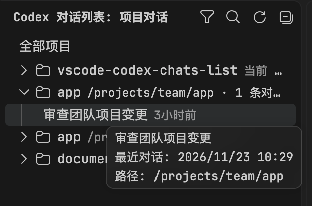

# Codex Chats List

[English](README.md) · 简体中文

按项目浏览已有的 Codex 对话，并在官方侧栏中继续。VS Code 原生项目树支持标题筛选、分页和刷新。

## 安装和浏览

1. 安装并登录 [官方 Codex 扩展](https://marketplace.visualstudio.com/items?itemName=openai.chatgpt)。
2. 在扩展商店搜索 `@id:pujie.codex-chats-list` 安装 **Codex Chats List**。使用离线包时，选择 **扩展 → … → 从 VSIX 安装**。
3. 打开项目文件夹，点击活动栏的 **Codex 对话列表**。也可在命令面板执行 **Codex Chats List: 打开项目对话**。
4. 展开项目并选择对话，官方 Codex 侧栏会在原有位置打开对应会话。

[Marketplace 商品页](https://marketplace.visualstudio.com/items?itemName=pujie.codex-chats-list) · [反馈问题](https://github.com/jaypume/vscode-codex-chats-list/issues)

| 操作 | 使用方式 |
| --- | --- |
| 切换范围 | 从标题栏打开 **切换对话范围**，选择 **当前项目** 或 **全部项目**。 |
| 按标题筛选 | 打开 **搜索对话标题**，输入关键词并回车。结果继续按项目分组。点击 **清除对话搜索**，或提交空关键词以还原列表。 |
| 查看详情 | 每条对话显示最近对话时间。悬停查看完整标题、时间和项目路径。 |
| 加载和刷新 | 点击树末尾的 **加载更多对话**。点击 **刷新对话** 重新读取第一页。 |

当前项目精确匹配工作目录，兼顾工作区符号链接的真实路径。子目录和 worktree 分别分组，可在 **全部项目** 中查看。没有打开文件夹时也可浏览全部项目。同名项目显示路径。

Codex 在分页前按标题和目录筛选。每页最多加载 50 条，计数表示已加载的结果。项目内按最近对话时间从新到旧排列，展示未归档的本地交互式对话。

视图可见时，每轮查询完成五秒后再次更新。后台刷新保留已加载页，隐藏侧栏时暂停轮询。范围和项目展开偏好按工作区保存。搜索时匹配的分组默认展开，清空筛选后回到普通项目树的展开偏好。

## 界面预览

以下截图使用示例数据。[英文预览](README.md#preview)提供对应界面。

| 当前项目 | 全部项目 |
| --- | --- |
|  |  |



## 兼容与隐私

扩展要求 VS Code 1.100 或更新版本。界面跟随 VS Code 的显示语言，中文环境使用简体中文，其他语言环境使用英文。对话标题和项目路径保留原文。

| 情况 | 处理方式 |
| --- | --- |
| 当前项目没有结果 | 会话的工作目录须与工作区根目录匹配。子目录或 worktree 下启动的对话可在 **全部项目** 中查找。 |
| 找不到 Codex | 启用官方扩展，或在 `codexChatsList.cliPath` 中指定当前宿主的可执行文件绝对路径。 |
| 打开对话失败 | 先打开官方 Codex 侧栏再试。跳转依赖官方扩展已有的 URI 路径，反馈时请附上两个扩展的版本。 |
| WSL、SSH 或容器 | 在远程工作区安装两个扩展。会话记录按宿主读取。Windows 将 Codex 转发到 WSL 时，请打开 WSL 工作区。 |

扩展通过本地官方 `codex app-server` 的 `thread/list` 读取会话 ID、标题、工作目录和最近对话时间，并启用 `useStateDbOnly`。没有标题时可使用服务提供的首条消息摘要。官方可执行文件管理自己的运行状态和日志。跳转使用官方扩展的 `/local/<id>` URI。

Codex Chats List 1.2.1 可以与 Codex Project Chats 同时启用。未配置 `codexChatsList.cliPath` 时，fork 读取旧的 `codexProjectChats.cliPath`。把新设置显式设为空字符串即可使用官方扩展内置的可执行文件。如果给 fork 的打开或刷新命令绑定了快捷键，请改绑 `codexChatsList.open` 或 `codexChatsList.refresh`。可将新的活动栏入口拖回习惯的位置。

## 开发与反馈

开发使用 `.nvmrc` 指定的 Node.js 24.18.0，以及 `packageManager` 指定的 pnpm 12.15.0。

```sh
pnpm install --frozen-lockfile
pnpm run check
pnpm run lint
pnpm run format:check
pnpm test
pnpm run package
```

扩展宿主编译到 `dist/extension/`。VSIX 包含编译后的宿主代码、图标、语言资源和公开文档，输出为 `release-artifact/codex-chats-list-<版本号>.vsix`。详见[开发说明](https://github.com/jaypume/vscode-codex-chats-list/blob/main/CONTRIBUTING.md)和[发布流程](https://github.com/jaypume/vscode-codex-chats-list/blob/main/docs/releasing.md)。

普通问题可在 [Issues](https://github.com/jaypume/vscode-codex-chats-list/issues) 反馈，漏洞请按[安全说明](https://github.com/jaypume/vscode-codex-chats-list/blob/main/SECURITY.md)私密提交。本扩展是 [Codex Project Chats](https://github.com/cixiangtao/codex-project-chats) 的独立 fork，采用 MIT 许可。
