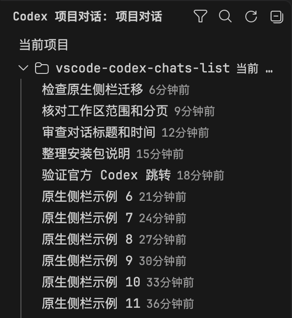
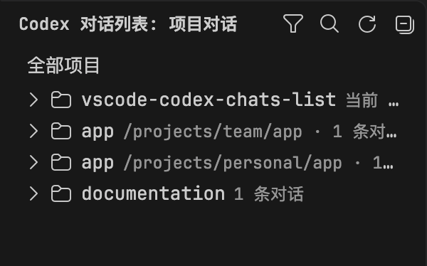

# Codex Chats List

[English](README.md) · 简体中文

按项目浏览已有的 Codex 对话，并在官方侧栏中继续。VS Code 原生项目树支持标题筛选、分页和刷新。

## 安装和浏览

1. 安装并登录 [官方 Codex 扩展](https://marketplace.visualstudio.com/items?itemName=openai.chatgpt)。
2. 在扩展商店搜索 `@id:pujie.codex-chats-list` 安装 **Codex Chats List**。使用离线包时，选择 **扩展 → … → 从 VSIX 安装**。
3. 打开项目文件夹，点击活动栏的 **Codex 对话列表**。也可在命令面板执行 **Codex Chats List: 打开项目对话**。
4. 展开项目并选择对话，官方 Codex 侧栏会在原有位置打开对应会话。

[Marketplace 商品页](https://marketplace.visualstudio.com/items?itemName=pujie.codex-chats-list) · [反馈问题](https://github.com/jaypume/vscode-codex-chats-list/issues)

| 操作 | 使用方式 |
| --- | --- |
| 切换范围 | 从标题栏打开 **切换对话范围**，选择 **当前项目** 或 **全部项目**。 |
| 分组和过滤 | 从标题栏打开 **选择对话分组**，选择 **按 Git 仓库** 或 **按目录**。视图菜单提供 **显示或隐藏普通文件夹**。 |
| 搜索标题 | 点击放大镜输入关键词，列表在选中的 **当前项目** 或 **全部项目** 范围内实时筛选。回车保留筛选，Esc 恢复上一次结果。点击 **清除对话搜索** 可还原列表。 |
| 查看详情 | 每条对话显示最近对话时间。悬停查看完整标题、时间和项目路径。 |
| 全部项目排序 | 切到 **全部项目**，在视图的 **…** 菜单选择 **项目排序**，可按名称或最近一次对话时间排列。 |
| 置顶项目或对话 | 右键点击项目分组或对话，选择 **置顶** 或 **取消置顶**。置顶分组排在列表最上方；置顶对话排在所属分组内最前面。 |
| 隐藏或恢复显示 | 右键点击项目分组或对话，选择 **隐藏**。通过 **… → 切换隐藏项视图** 查看隐藏项，再右键选择 **恢复显示**。 |
| 删除对话 | 右键点击对话或项目分组，选择 **删除对话…**，确认后在 Codex 中永久删除。项目删除覆盖该分组已索引的所有对话，包括当前过滤和分页之外的记录。 |
| 加载和刷新 | **全部项目** 直接显示所有已索引的分组和对话。**当前项目** 可点击 **加载更多对话** 翻页。点击 **刷新对话** 检查近期活动。 |

**按 Git 仓库** 时，当前项目匹配工作区仓库的 `origin` 或 `upstream`，因此可找回搬家前的会话。没有远程的本地仓库按 Git 根目录归组。

GitHub 仓库改名后，扩展可按确认的仓库 ID 合并历史。分组详情优先显示当前工作区中匹配的 Git 根目录，其次使用最近使用且仍能验证的目录。会话提示保留各自的原始路径。仓库元数据缓存于本地，私有仓库使用已有的 GitHub CLI 登录，公开仓库也可匿名查询。

普通文件夹用名称显示，用路径区分同名组。旧目录失联且 Codex 没有保存 Git 身份时，分组标为 **来源未确认**。过滤只隐藏已确认属于普通文件夹的分组。**按目录** 保留工作目录分组，**当前项目** 精确匹配工作区路径。

首次后台逐页建立索引，每一页都能立即显示。使用相同 VS Code 配置、扩展宿主和 Codex 数据源的窗口共享这份索引。切换范围、分组、标题搜索和翻页从本地读取。后台仅在视图可见时检查近期活动。

索引保存列表元数据以及去除凭据后的仓库键。点击已缓存会话时会向 Codex 校验该条记录。较早会话的改名或归档可能延迟到点开时才反映。缺少 Node SQLite 的扩展宿主使用进程内索引。

排序按工作区记忆。使用同一 VS Code 配置和扩展宿主的窗口共享置顶和隐藏状态。

## 界面预览

以下截图使用示例数据。[英文预览](README.md#preview)提供对应界面。

| 当前项目 | 全部项目 |
| --- | --- |
|  |  |


## 兼容与隐私

扩展要求 VS Code 1.100 或更新版本。界面跟随 VS Code 的显示语言，中文环境使用简体中文，其他语言环境使用英文。对话标题和项目路径保留原文。

| 情况 | 处理方式 |
| --- | --- |
| 当前项目没有结果 | 可切到 **按 Git 仓库** 查找同仓库的其他 checkout 或 worktree 会话。**全部项目** 还可浏览其他已索引目录。 |
| 找不到 Codex | 启用官方扩展，或在 `codexChatsList.cliPath` 中指定当前宿主的可执行文件绝对路径。 |
| 打开对话失败 | 先打开官方 Codex 侧栏再试。跳转依赖官方扩展已有的 URI 路径，反馈时请附上两个扩展的版本。 |
| WSL、SSH 或容器 | 在远程工作区安装两个扩展。会话记录按宿主读取。Windows 将 Codex 转发到 WSL 时，请打开 WSL 工作区。 |

扩展通过本地官方 `codex app-server` 的 `thread/list` 读取会话 ID、标题、工作目录、最近对话时间和可用的 Git 远程元数据，并启用 `useStateDbOnly`。没有标题时可使用服务提供的首条消息摘要。官方可执行文件管理自己的运行状态和日志。跳转使用官方扩展的 `/local/<id>` URI。

Codex Chats List 1.2.1 可以与 Codex Project Chats 同时启用。未配置 `codexChatsList.cliPath` 时，fork 读取旧的 `codexProjectChats.cliPath`。把新设置显式设为空字符串即可使用官方扩展内置的可执行文件。如果给 fork 的打开或刷新命令绑定了快捷键，请改绑 `codexChatsList.open` 或 `codexChatsList.refresh`。可将新的活动栏入口拖回习惯的位置。

## 开发与反馈

开发使用 `.nvmrc` 指定的 Node.js 24.18.0，以及 `packageManager` 指定的 pnpm 12.15.0。

```sh
pnpm install --frozen-lockfile
pnpm run check
pnpm run lint
pnpm run format:check
pnpm test
pnpm run package
```

扩展宿主编译到 `dist/extension/`。VSIX 包含编译后的宿主代码、图标、语言资源和公开文档，输出为 `release-artifact/codex-chats-list-<版本号>.vsix`。详见[开发说明](https://github.com/jaypume/vscode-codex-chats-list/blob/main/CONTRIBUTING.md)和[发布流程](https://github.com/jaypume/vscode-codex-chats-list/blob/main/docs/releasing.md)。

普通问题可在 [Issues](https://github.com/jaypume/vscode-codex-chats-list/issues) 反馈，漏洞请按[安全说明](https://github.com/jaypume/vscode-codex-chats-list/blob/main/SECURITY.md)私密提交。本扩展是 [Codex Project Chats](https://github.com/cixiangtao/codex-project-chats) 的独立 fork，采用 MIT 许可。
