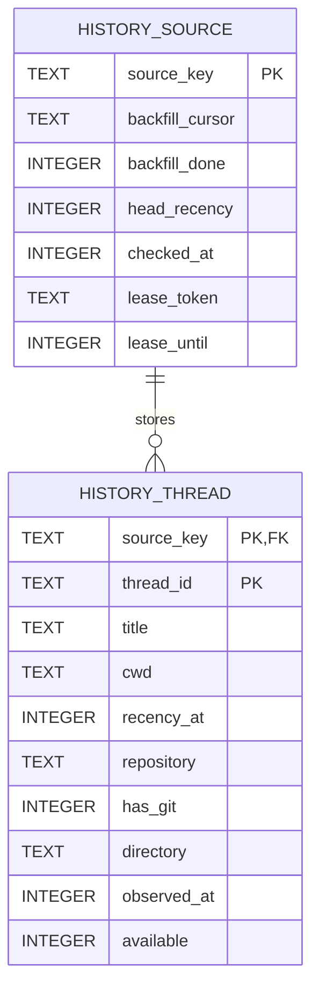

# 会话索引 Schema

索引位于扩展的全局存储目录。它保存列表需要的元数据和分页进度，Codex 继续管理会话正文。

## 实体关系

- `source_key` 根据 app-server 的 Codex 数据目录生成。服务端未提供数据目录时加入配置的可执行文件路径和环境中的数据目录。索引仅由同一 VS Code 配置和扩展宿主共享。
- `backfill_cursor` 保存未过滤历史的后续游标，`backfill_done` 区分扫描前的空游标和扫描结束。首轮扫描结果与游标在同一事务写入。
- `head_recency` 是已覆盖的最近活动时间，单位为秒。首次列表和增量列表均按时间倒序读取，增量读取覆盖前一个时间边界的同秒会话。只有完成一轮增量读取后才推进边界。 `checked_at` 为最近一轮增量完成的毫秒时间戳。
- 索引以数据源和会话 ID 为主键。仓库键已去除远程地址的用户信息和查询参数。`directory` 保存经本地 Git 检查确认的目录类型、根目录和公共 Git 目录，格式为 JSON。
- `observed_at` 记录请求开始的毫秒时间戳。主动删除在 Codex 确认成功后记录完成时间。`available` 为 0 的已归档或已删除记录优先于同一时刻或更早开始的扫描结果。
- 查询进程先认领有效期有限的租约。每次提交确认租约仍归自己所有。已过期的租约可被另一窗口接管。
- 首次创建使用版本 1 的独立 SQLite 文件。索引由会话元数据重建。无法加载 Node SQLite 的宿主使用内存索引。
